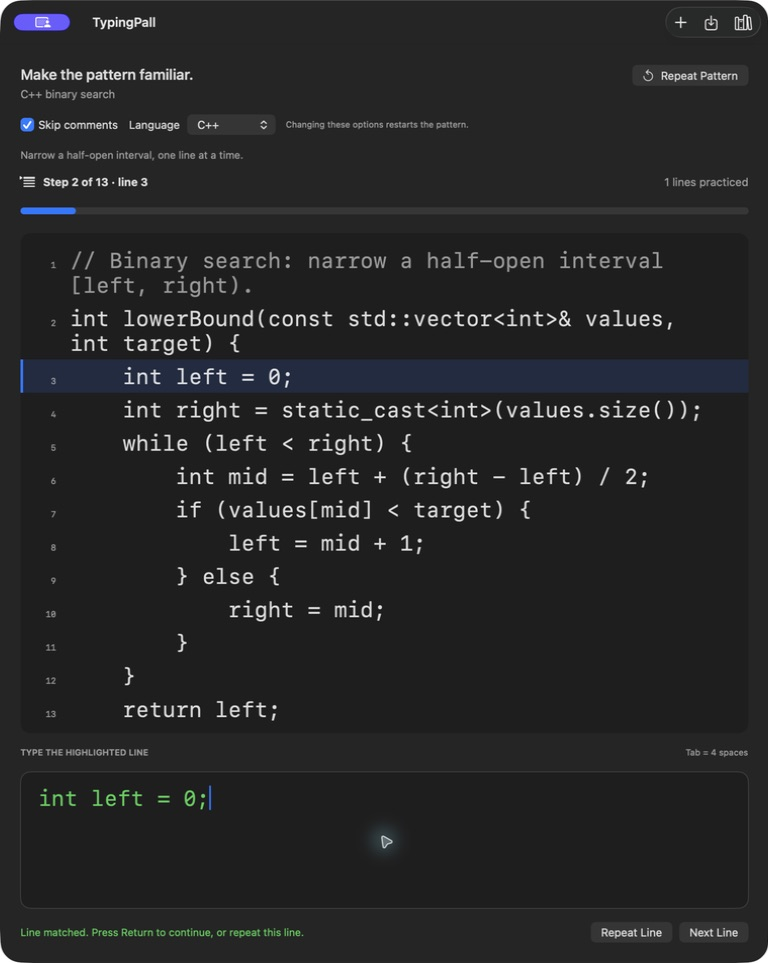
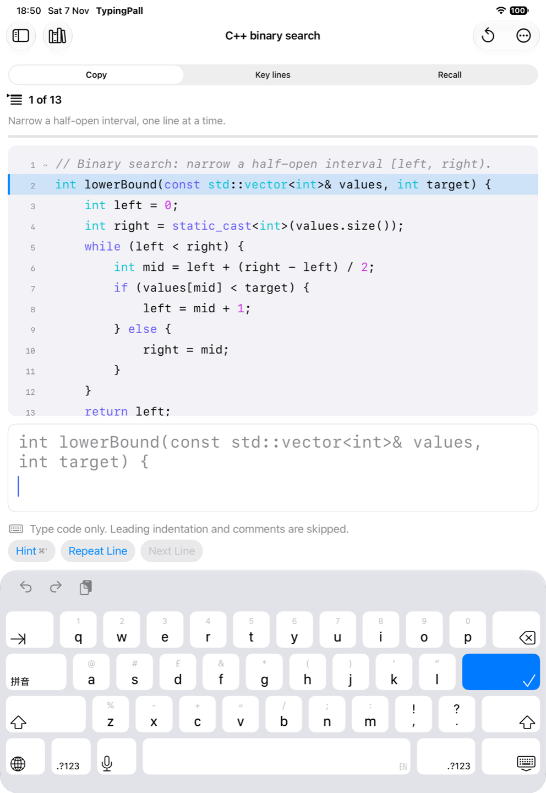
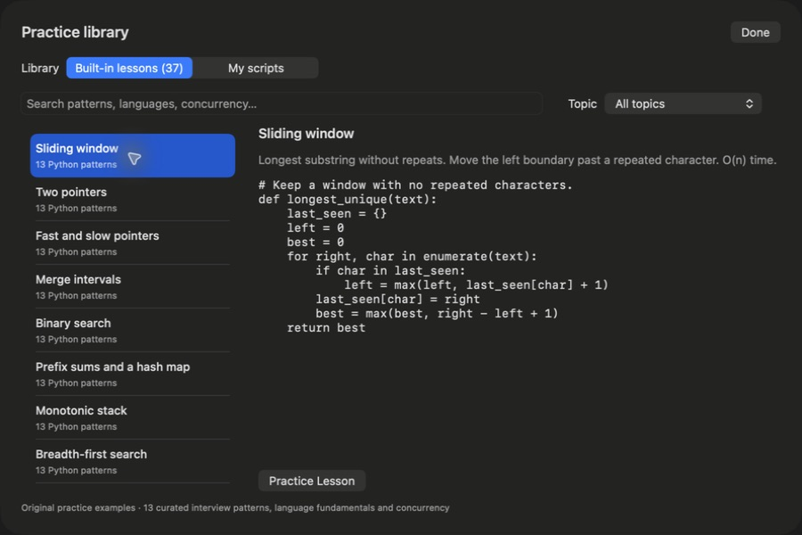

<div align="center">

# TypingPall

**Make code patterns familiar, one line at a time.**

A native Mac and iPad app for practicing algorithms, low-level design, language idioms, and concurrency.

[](https://github.com/Mieraidihaimu/TypingPall/actions/workflows/run_tests.yml)


[](LICENSE)

[Get started](#get-started) · [Explore the lessons](#lessons-ready-to-practice) · [Contribute](CONTRIBUTING.md)

</div>

Reading an algorithm is one step. Writing it again helps you notice the details. TypingPall keeps a complete code pattern in view while you reproduce it line by line, correct differences, and repeat the parts you want to remember.

<p align="center">
  
</p>

## A small, focused practice loop

1. **Choose a pattern.** Open a built-in lesson, paste your own snippet, or import a source file.
2. **Type the line shown above the input.** Copy shows syntax-highlighted code and underlines input from the first difference. Practice skips leading indentation, blank lines, and code comments while keeping the full source visible in Copy.
3. **Press Return to continue.** Repeat a tricky line or restart the entire pattern whenever you want. When you finish, the next lesson is one Return away.

On Mac, press **⇧⌘D** to open *Which pattern?* and identify a pattern from a short scenario before you write it.

- **164 built-in lessons in three tracks** (LeetCode, Low-level design, Languages & syntax) across Python, Swift, C++, Rust, Go, Ruby, and Shell, with search and topic filters.
- **Recall notes** cover cues, invariants, pitfalls, and related problems for selected lessons. Library search matches the cues.
- **Practice from memory.** Key lines hides selected lines, and Recall hides the body of the pattern. Both check your answer on Return, reveal one token at a time on request, and grade the attempt without a time limit.
- **Your own practice library** stores imported and pasted patterns locally.
- **Offline practice** with no account, analytics, or third-party runtime dependencies.
- **Adjustable input** with monospaced text sizing, tab width, and an optional on-screen keyboard layout on Mac.

## Get started

### Download for macOS

Download the DMG from [GitHub Releases](https://github.com/Mieraidihaimu/TypingPall/releases/latest), open it, and drag **TypingPall** into **Applications**. The download requires an Apple Silicon Mac with macOS 14 or later.

The 1.2.0 download is ad hoc signed. See the [1.2.0 release notes](https://github.com/Mieraidihaimu/TypingPall/releases/tag/v1.2.0) for first-launch instructions and checksums.

### Build for macOS

Clone the repository and open the project in Xcode.

```sh
git clone https://github.com/Mieraidihaimu/TypingPall.git
cd TypingPall
open TypingPall.xcodeproj
```

Select the **TypingPall** scheme, choose **My Mac**, and press **⌘R**. The app targets macOS 14 or later. If Xcode requests signing configuration, choose your development team under Signing & Capabilities.

Start with the C++ binary-search exercise, or press **⌘L** to pick a lesson. Open **Search** (⌘K) or **Settings → Library** to add a script, import a UTF-8 source file, or browse the library.

### Build for iPad

In Xcode 26 or later, select the **TypingPallPad** scheme and run on an iPad or simulator with iPadOS 26 or later. For a physical iPad, select your development team for the TypingPallPad target. The same project contains the Mac and iPad apps.

The iPad app supports Copy, Key lines, and Recall. Type with a hardware keyboard or the onscreen keyboard, then press **Return** or tap the line action. Open **Library** to browse lessons or saved scripts. Use **Actions** to add a snippet, import a UTF-8 file from Files, or change practice settings. Scripts and mastery are stored locally on the iPad.

<p align="center">
  
</p>

In Xcode, use **Product → Test** with the TypingPallPad scheme to run the shared practice tests and iPad UI tests.

## Lessons ready to practice

| Track | Collection | Examples |
| --- | --- | --- |
| LeetCode | Python interview patterns | Merge sort, quicksort, heap sort, sliding windows, two pointers, binary search, graph traversal, backtracking, greedy packing, merging sorted streams, union-find and dynamic programming |
| LeetCode | Python data structures | Fixed-size arrays, linked lists, queues, deques, hash maps, search trees (BST, AVL and red-black), N-ary trees, tries, priority queues, graph adjacency lists and matrices |
| LeetCode | Swift interview patterns | Lower-bound binary search, Unicode sliding window, interval merging, BFS, bracket matching, coin-change dynamic programming |
| Low-level design | Creational, structural and behavioral patterns | Factory, builder, singleton, adapter, decorator, composite, strategy, state, observer, command, chain of responsibility |
| Low-level design | Design building blocks | LRU cache, token-bucket rate limiter |
| Low-level design | Reliable components | Idempotent reservations, fencing tokens for lease holders, retries with a shared deadline |
| Languages & syntax | Terminal commands | File search, text pipelines, process inspection, git workflows, archiving |
| Languages & syntax | Python fundamentals | Comprehensions, collections, generators, dataclasses, context managers, decorators, itertools, protocols |
| Languages & syntax | Ruby fundamentals | Blocks and enumeration, classes and mixins, keyword arguments, exceptions, procs, regex |
| Languages & syntax | Go fundamentals | Slices, errors, methods, interfaces, defer/recover, generics, JSON struct tags, timeouts |
| Languages & syntax | C++ fundamentals | Vectors, hash maps, ownership, lambda sorting |
| Languages & syntax | Rust fundamentals | Borrowing, `Result`, iterators, enums |
| Languages & syntax | Swift fundamentals | Optionals, enums, value semantics, closures, collections, Unicode strings, protocols, generics, errors, Codable, key paths, property wrappers, ARC, sequences |
| Languages & syntax | Swift concurrency | Async/await, async let, task groups, actors, cooperative cancellation, AsyncStream |
| Languages & syntax | Concurrency across four languages | Thread pools, async tasks, mutexes, condition variables, channels |
| Languages & syntax | Advanced concurrency | Lock ordering, bounded queues and shutdown, async request coalescing, cancellable channel fan-in, actor reentrancy, acquire/release memory ordering |

For senior practice, try **Advanced concurrency** and **Reliable components**. The Python and C++ exercises cover bounded submission, resource leases, deadlines, and safe updates to shared state. Use the recall prompts to explain which rule keeps the code correct under contention, cancellation, or retries, then type the key lines.



Browse the [lesson source files](library/lessons/) or the [bundled catalog](TypingPall/Content/lessons.json).

## macOS shortcuts

| Action | Shortcut |
| --- | --- |
| Confirm the current line | Return |
| Copy, Key lines, Recall | ⌘1, ⌘2, ⌘3 |
| Hint | ⌘' |
| Repeat the pattern | ⌘R |
| Open the library | ⌘L |
| Which pattern? drill | ⇧⌘D |
| Import a file | ⌘O |
| Add a script | ⇧⌘N |

## A few useful details

In Copy, **Strict** spacing checks internal and trailing spaces. **Relaxed** spacing accepts some whitespace differences around punctuation and operators while preserving spaces inside strings.

Imports accept UTF-8 files up to 1 MB and 20,000 normalized characters. Line endings are normalized, tabs expand to your configured width, and Unicode is preserved. The practice input accepts one line at a time; paste complete snippets into **Add Script**. Saved patterns survive relaunches; your current practice position does not.

**Save & Practice** opens your script for practice and saves it under **Library → My scripts**.
Search and reopen saved scripts and imported files there.

Plain text keeps comment markers as ordinary text. Python docstrings stay in the exercise.

## Build and contribute

Bug reports, clearer lessons, accessibility improvements, and small fixes are welcome. Start with the [contribution guide](CONTRIBUTING.md), [report a bug](https://github.com/Mieraidihaimu/TypingPall/issues/new?template=bug_report.yml), or [suggest a lesson](https://github.com/Mieraidihaimu/TypingPall/issues/new?template=lesson_request.yml).

```sh
# Unit tests, UI tests, and an Apple silicon + Intel Release build
./scripts/check.sh

# Unit tests and the Release build, without desktop UI automation
./scripts/check.sh -only-testing:TypingPallTests

# Validate the bundled lesson examples with available language toolchains
python3 scripts/check_lessons.py
```

UI tests require a logged-in desktop and permission for the Xcode test runner to control it. See the [release guide](RELEASE.md) for distribution checks and the [documentation archive](docs/archive/README.md) for historical design notes.

If TypingPall earns a place in your practice routine, a star helps other developers find it.

Created by Mier, with thanks to [everyone who contributes](https://github.com/Mieraidihaimu/TypingPall/graphs/contributors). Licensed under [GPL-3.0](LICENSE).
